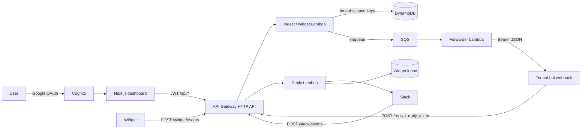
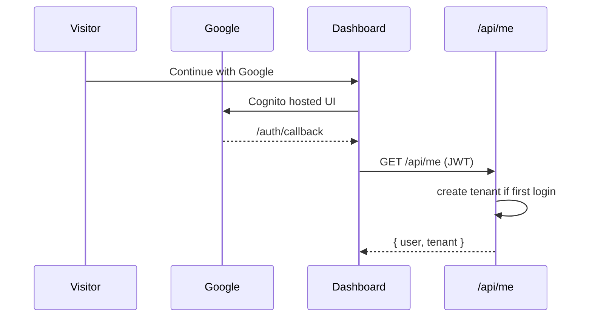

# easy-ai-bot-bridge

This repository has two independent pieces:

| Piece | Path | Status |
| --- | --- | --- |
| **Relay** | [`relay/slack-webhook-relay/`](relay/slack-webhook-relay/) | Active. Simple, one Slack workspace, one Lambda Function URL. |
| **Bridge** | root CDK + `apps/web` | Paused. Multi-tenant hosted service (Google login, dashboard, DynamoDB, SQS). Kept for later. |

A Grok Bot connected to Slack natively only replies to its owner. The **relay** is
the path to use now: Slack Events API -> Lambda -> Grok Bot routine webhook; the bot
posts back to Slack with `chat.postMessage`. See
[`relay/slack-webhook-relay/README.md`](relay/slack-webhook-relay/README.md) for Slack
app setup, deploy, and the routine prompt.

```bash
cd relay/slack-webhook-relay
npm ci
npm test
npx cdk deploy
```

CloudFormation output **`FunctionUrl`** is the Slack Event Subscriptions Request URL.

The rest of this file documents the multi-tenant **bridge**, which is not being
deployed for now.

## Multi-tenant bridge (paused)

Hosted, multi-tenant webhook bridge. Anyone signs in with **Google** (no email/password
accounts). A private tenant is created on first login. Inside a tenant you connect bots
(webhook URL + bearer key) and channels (Slack via Add to Slack, an embeddable website
widget, Telegram stub). Across tenants, nothing is shared.

This service would give each tenant their own Slack install: anyone in that workspace
can @-mention the app, the bridge forwards the message to the linked bot webhook, and
the bot's answer is posted back into the same Slack thread.

The core is platform-agnostic. Each chat network is a thin adapter. Telegram is stubbed,
not implemented.

This repository does **not** deploy the bridge itself. You would need an AWS account,
one Slack app, and Google OAuth credentials; see [Deploy](#deploy).

## Auth (Google only)

There is **no separate sign-up form and no email/password accounts**. The dashboard
button is "Continue with Google", matching [easy-ai-resume](https://github.com/xiaopai20/easy-ai-resume):

1. Cognito User Pool with `selfSignUpEnabled: false`.
2. Google is the only identity provider (when `GOOGLE_CLIENT_ID` / `GOOGLE_CLIENT_SECRET`
   are set at deploy).
3. After Google OAuth, the dashboard calls `GET /api/me`. If the Cognito `sub` has no
   tenant yet, the API creates one and stores the mapping. Later logins reuse it.

## Architecture





| Piece | Role |
| --- | --- |
| Cognito + Google | Only login. No password users. |
| Next.js dashboard (`apps/web`) | Connect bots and channels, Add to Slack, copy widget snippet, usage, admin overrides |
| API Gateway HTTP API | Public: `/slack/events`, `/slack/oauth/callback`, `/reply`, `/widget/*`. JWT on `/api/{proxy+}` |
| Ingest Lambda | Slack sig + timestamp, map `team_id` to tenant, ignore bot/self, dedupe `event_id`, enqueue, ack under 3s |
| Widget Lambda | Public token lookup, enqueue, inbox poll, `/widget.js` |
| SQS + DLQ | Buffer + 5 retries then dead-letter |
| Forwarder Lambda | POST JSON + tenant bot bearer key |
| Reply Lambda | HMAC token includes `tenantId`; Slack `chat.postMessage` or widget inbox |
| DynamoDB `events` / `threads` / `routes` | Tenant-prefixed keys, TTLs on events/threads |
| DynamoDB `directory` | Tenants, user mapping, bots, channels, Slack team uniqueness, widget tokens |
| DynamoDB `inbox` | Website widget transcripts |
| Secrets Manager + KMS | Platform secret (Slack signing + OAuth client + callback HMAC) plus per-tenant bot keys and Slack bot tokens |

**Design choices:**

- **HMAC reply tokens** are JSON `{ tenantId, threadId, exp }` signed with
  `callbackSigningSecret`. Thread ids are `{tenantId}:{platform}:...`. A token from
  tenant A cannot post to tenant B.
- **No global `DEFAULT_TARGET_WEBHOOK_URL`.** A shared default would mix tenants onto
  one webhook. Every inbound message needs a tenant-owned route.
- One Slack **team id** maps to at most one tenant (conditional put). Connecting a
  workspace that another tenant owns returns 409.
- Routes, threads, events, inbox rows, reply tokens, and secrets are scoped by
  `tenantId`. Lookups always filter on that id.
- Lambdas run **arm64 / 256 MB**. Ingest timeout is 5s.

## Tenant isolation

Within a tenant, any channel can link to any bot. Across tenants:

- Dashboard list/get/delete of another tenant's bot or channel returns 404
- Slack events for a workspace owned by A never use B's routes
- `event_id` dedupe is per tenant, so the same Slack event id can process in two tenants
- A reply token issued for A cannot post to B's thread (401)
- A widget token for A cannot read B's inbox

See `test/isolation.test.ts`.

## Quotas and rate limits

Every tenant starts with the same defaults (override with Lambda env or CDK context):

| Limit | Default |
| --- | --- |
| `maxBots` | 5 |
| `maxChannels` | 5 |
| `maxRoutes` | 20 |
| `messagesPerMinute` | 120 |
| `messagesPerDay` | 10_000 (UTC day) |
| `loopMessagesPerThreadPerMinute` | 20 |

Create bot/channel/route returns HTTP 400 when the cap is reached. Message caps are
enforced on ingest and `/reply`: over-limit inbound messages are not forwarded (Slack
still gets HTTP 200 so it does not retry). The tenant gets **one** Slack/widget notice
per minute. `/reply` returns **429**. Two bots ping-ponging in the same thread are
stopped when that thread exceeds `loopMessagesPerThreadPerMinute` in a UTC minute;
the bridge logs `loop_detected` and does not forward.

Per-tenant overrides live on the directory table (`pk=TENANT#{id}`, `sk=LIMITS`) and
are merged onto the defaults. Set them from the dashboard **Admin** page (allowlisted
Google emails) or:

```bash
# Allowlist (comma-separated, case-insensitive). Empty means nobody is admin.
npx cdk deploy -c adminEmails="you@example.com,ops@example.com"

# Or patch after deploy:
# PATCH /api/admin/tenants/{tenantId}/limits
# Authorization: Bearer <Cognito JWT of an allowlisted email>
# { "messagesPerMinute": 30, "maxBots": 8 }
```

`ADMIN_EMAILS` is also read from the Lambda environment. Defaults can be changed with
`MAX_BOTS`, `MAX_CHANNELS`, `MAX_ROUTES`, `MESSAGES_PER_MINUTE`, `MESSAGES_PER_DAY`,
`LOOP_MESSAGES_PER_THREAD_PER_MINUTE`.

API Gateway HTTP API default-stage throttle is 50 requests/second, burst 100.

### Settings cache

Routes, Slack team mappings, widget tokens, channels, limits, and tenant secrets are
cached in memory on each Lambda container (`TtlCache`, default 60s,
`SETTINGS_CACHE_TTL_SECONDS`). There is no Redis and no cross-container invalidation.
Dashboard writes bump `configVersion` and drop matching keys **in that container**.
Other containers may see the previous value until TTL. **When the cache is warm, the
hot path does not read DynamoDB for settings.**

### DynamoDB operations per forwarded message

The hot path never uses `TransactWrite`. Minute and day counters share **one**
`UpdateItem` on a per-tenant UTC-day item (`pk=rate#{tenantId}#d#{yyyy-mm-dd}`) that
holds `dayCount`, `minuteBucket`, and `minuteCount`. Loop protection piggybacks on the
thread mapping write (`loopMinute` / `loopCount`). Dedupe is a separate conditional
`Put` because it keys on `event_id`, not the tenant.

**Inbound Slack/widget message that is forwarded (cache warm):**

| # | Table | Op | Item | Why |
| --- | --- | --- | --- | --- |
| 1 | `events` | `Put` (condition `attribute_not_exists`) | `event#{tenant}#{platform}#{eventId}` | Durable dedupe |
| 2 | `events` | `Update` | `rate#{tenant}#d#{day}` | Minute + day quota together |
| 3 | `threads` | `Update` | `thread#{tenant}#{threadId}` | Mapping + loop counter |

Zero DynamoDB **reads** for route / Slack team / widget token / channel / limits.

**Bot `/reply` that is posted (cache warm):**

| # | Table | Op | Item | Why |
| --- | --- | --- | --- | --- |
| 1 | `threads` | `Get` | thread mapping | Need channel / `thread_ts` |
| 2 | `events` | `Update` | day quota item | Same combined counter |
| 3 | `threads` | `Update` | thread mapping | Loop counter on the existing row |

A fourth write (`Put` of a notice flag on `events`) happens only when the tenant is
over limit, and at most once per minute. Widget transcripts add inbox `Put`s on that
path only.

Three writes per inbound message is the minimum that still keeps durable per-event
dedupe (different key) and a thread mapping (different table). Combining minute/day
into one item avoids a second counter write; putting the loop counter on the thread
item avoids a third counter write. A `TransactWrite` of those items would cost more
WCUs for the same durability.

## Adapter interface

```ts
export interface PlatformAdapter {
  readonly platform: string;
  verifyRequest(args: VerifyRequestArgs): void;
  parseInbound(body: unknown, options?: { botUserId?: string }): InboundResult;
  postReply(args: {
    target: ReplyTarget;
    text: string;
    credentials: PlatformCredentials;
    fetchFn: typeof fetch;
  }): Promise<void>;
}
```

See `src/adapters/types.ts`. Slack is implemented. Website widget ingest lives in
`src/widget/handler.ts`. Telegram is a throwing stub in `src/adapters/telegram.ts`.

## Payload the bot receives

The forwarder POSTs JSON to the tenant bot webhook with

`Authorization: Bearer <that bot's webhook key>`

```json
{
  "thread": "t-tenant-a:slack:T0123456789:C0LAN2Q65:1731448800.000100",
  "text": "What is the weather today?",
  "sent_at": "2024-11-12T22:00:00.000Z",
  "platform": "slack",
  "sender": {
    "id": "U111",
    "display_name": null,
    "username": null
  },
  "conversation": {
    "workspace_id": "T0123456789",
    "channel_id": "C0LAN2Q65",
    "thread_ts": "1731448800.000100"
  },
  "reply_url": "https://xxxxxxxxxx.execute-api.us-east-1.amazonaws.com/reply",
  "reply_token": "<hmac-token>"
}
```

`thread`, `text`, and `sent_at` match a Grok Bot routine webhook (HTTP 200 in under 1s;
UTF-8 text is fine). Leading `<@UBOT>` mentions are stripped from `text`.

If the Slack event already has a `thread_ts`, that is the conversation id. Otherwise the
message `ts` is used so `chat.postMessage` opens a thread on the mention.

## Curl the bot should run to reply

Use `reply_url` and `reply_token` from the payload. Do **not** send the Slack bot token;
the bridge holds that per tenant.

```bash
REPLY_URL="https://xxxxxxxxxx.execute-api.us-east-1.amazonaws.com/reply"
REPLY_TOKEN="<hmac-token>"
THREAD="t-tenant-a:slack:T0123456789:C0LAN2Q65:1731448800.000100"

curl -sS -X POST "$REPLY_URL" \
  -H "Authorization: Bearer $REPLY_TOKEN" \
  -H "Content-Type: application/json; charset=utf-8" \
  -d "$(jq -n --arg thread "$THREAD" --arg text "Sunny, 20C." '{thread:$thread, text:$text}')"
```

Expected response: `{"ok":true}`. Tokens expire after 7 days. A 401 means a bad/expired
or cross-tenant token; 404 means the thread mapping is gone.

## Dashboard

`apps/web` is a Next.js 14 app (stone-50 / amber, same look as easy-ai-resume):

- Landing: **Continue with Google** only
- `/auth/callback`: Amplify finishes the Cognito code grant, then redirects to `/app`
- `/app`: first `GET /api/me` creates the tenant; then CRUD bots, website widgets,
  Telegram stubs, **Add to Slack**, embed snippet, link any channel to any bot, usage
- `/admin`: allowlisted Google emails set per-tenant limit overrides

Local:

```bash
cd apps/web
cp .env.example .env.local
npm install
npm run dev   # http://localhost:3002
```

Without Cognito env vars (or on localhost) the UI uses a mock Google user so you can
click through the dashboard. The API still needs a real JWT unless you set `DEV_MODE=true`
on the dashboard Lambda.

## Slack app setup (one app for the whole service)

You create **one** Slack app. Tenants install it with Add to Slack. Their bot token is
stored under that tenant, encrypted with KMS.

1. [Create a Slack app](https://api.slack.com/apps) from scratch.
2. **OAuth & Permissions**
   - Redirect URL = CloudFormation output `SlackOAuthCallbackUrl`
     (`https://{api-id}.execute-api.{region}.amazonaws.com/slack/oauth/callback`)
   - Bot Token Scopes: `app_mentions:read`, `chat:write`, `im:history`, `im:read`
3. **Event Subscriptions**
   - Request URL = output `SlackEventsUrl`
   - Bot events: `app_mention`, `message.im`
   - Put the **signing secret** in Secrets Manager **before** you set the Request URL.
     Slack POSTs `url_verification`; this app returns the `challenge` as plaintext.
4. Copy Client ID, Client Secret, and Signing Secret into the platform secret (below).
5. Each tenant clicks **Add to Slack** in the dashboard, then `/invite @YourBot` in channels.

## Website widget

Create a widget channel in the dashboard and paste the snippet:

```html
<script src="https://{api}/widget.js" data-token="wgt_..." data-api="https://{api}"></script>
```

The script posts to `/widget/events` and polls `/widget/messages`. Replies from the bot
go to the tenant inbox, not to Slack.

## Deploy

You need Node 22+, AWS credentials that can create API Gateway, Lambda, SQS, DynamoDB,
Secrets Manager, KMS, Cognito, IAM, and CloudWatch Logs.

### 1. Google OAuth

In [Google Cloud Console](https://console.cloud.google.com/) create an OAuth 2.0 Web
client. Authorized redirect URIs:

- `https://<cognito-domain>/oauth2/idpresponse`
- `https://<dashboard-host>/auth/callback`

Save Client ID and Client Secret.

### 2. Synth and deploy the API

```bash
npm ci
npm test
npm run synth
export CDK_DEFAULT_REGION=us-east-1
npx cdk bootstrap aws://$AWS_ACCOUNT_ID/$CDK_DEFAULT_REGION
npx cdk deploy \
  -c googleClientId="$GOOGLE_CLIENT_ID" \
  -c googleClientSecret="$GOOGLE_CLIENT_SECRET" \
  -c callbackUrl=https://your-dashboard.example \
  -c corsOrigin=https://your-dashboard.example \
  -c adminEmails="you@example.com"
```

Without Google context, CDK still synths (Cognito placeholder client) but production
login will not work until you redeploy with Google credentials.

Note the outputs: `ApiUrl`, `SlackEventsUrl`, `SlackOAuthCallbackUrl`, `ReplyUrl`,
`SecretArn`, `UserPoolId`, `UserPoolClientId`, `CognitoDomain`, `DirectoryTableName`.

### 3. Platform secret

Deploy creates one secret:

```json
{
  "slackSigningSecret": "REPLACE_ME",
  "slackClientId": "REPLACE_ME",
  "slackClientSecret": "REPLACE_ME",
  "callbackSigningSecret": "<randomly generated>"
}
```

Keep `callbackSigningSecret`. Replace the Slack values:

```bash
aws secretsmanager get-secret-value --secret-id "$SECRET_ARN" \
  --query SecretString --output text > /tmp/bridge-secret.json
# edit /tmp/bridge-secret.json -- do not commit it
aws secretsmanager put-secret-value --secret-id "$SECRET_ARN" \
  --secret-string file:///tmp/bridge-secret.json
rm /tmp/bridge-secret.json
```

Per-tenant bot webhook keys and Slack bot tokens are created automatically under
`easy-ai-bot-bridge/{env}/tenants/{tenantId}/...` and encrypted with the tenant KMS key.
Do not put tenant secrets in the platform secret.

### 4. Dashboard (Amplify Hosting)

Connect this repo in Amplify. Build uses `amplify.yml` (`apps/web`). Set:

```env
NEXT_PUBLIC_API_URL=<ApiUrl>
NEXT_PUBLIC_COGNITO_USER_POOL_ID=<UserPoolId>
NEXT_PUBLIC_COGNITO_CLIENT_ID=<UserPoolClientId>
NEXT_PUBLIC_COGNITO_DOMAIN=<CognitoDomain>
NEXT_PUBLIC_REDIRECT_SIGN_IN=https://<dashboard-host>/auth/callback
NEXT_PUBLIC_REDIRECT_SIGN_OUT=https://<dashboard-host>
```

`NEXT_PUBLIC_COGNITO_DOMAIN` is the hostname (no `https://`), for example
`eabb-dev-123456789012.auth.us-east-1.amazoncognito.com`.

After the first Amplify URL exists, update Cognito callback/logout URLs if they differ
from `callbackUrl` used at `cdk deploy`, and add that URL to the Google OAuth client.

This repo does not run `cdk deploy` in CI; there are no AWS, Slack, or Google credentials
in the environment that built it.

## Optional: write a route by hand

The dashboard writes routes when you link a channel. For debugging:

```bash
export ROUTES_TABLE=EasyAiBotBridge-RoutesXXXXXXXX
export TENANT_ID=t_...
export WORKSPACE_ID=T0123456789
export CHANNEL_ID=*
export TARGET_WEBHOOK_URL=https://your-grok-bot.example/routine
export TARGET_ID=bot_...
npx tsx scripts/put-route.ts
```

Keys: `pk` = `{tenantId}#{platform}#{workspaceId}`, `sk` = `channel#{channelId}` or
`channel#*`.

## Local tests

```bash
npm test
```

Covered without AWS, Slack, or Google:

- Slack signing secret + timestamp window
- `event_id` dedupe (including enqueue-failure rollback), per tenant
- Route lookup (channel / wildcard / mute). No global default
- `/reply` HMAC token, tenant prefix, 401/404, `chat.postMessage`
- Dashboard first Google login creates a tenant; CRUD bots/channels
- Slack OAuth callback stores a per-tenant bot token
- Widget round trip: visitor -> bot webhook -> inbox
- Isolation: bots, channels, routes, reply tokens, widget inbox, webhook keys
- Quotas: default merge, create caps, admin allowlist, per-tenant override
- Rate limit: no forward over cap, one notice per minute, `/reply` 429, loop protection
- Settings cache: warm-cache skips DynamoDB reads; TTL expiry; same-container invalidate
- Mocked path: Slack `app_mention` -> forwarded JSON -> `/reply` -> `chat.postMessage`
  (including a non-ASCII UTF-8 round trip using escaped Unicode)

```bash
npx cdk synth
```

must complete cleanly.

## AWS cost at low volume

Idle cost is dominated by **Secrets Manager**. The platform secret is always there.
Each connected bot and Slack workspace adds another secret.

Assumptions: ~1,000 mentions / month, a handful of tenants, 256 MB Lambdas, arm64,
on-demand DynamoDB, HTTP API, one SQS queue + DLQ, log retention 14 days.

| Service | ~1k msgs/month | Notes |
| --- | --- | --- |
| Secrets Manager | **$0.40 x N** | 1 platform secret + 1 per bot + 1 per Slack workspace |
| KMS | pennies | one CMK, rotation on |
| Cognito | $0.00 | well under the free MAU tier |
| API Gateway HTTP API | < $0.01 | $1.00 / million requests |
| Lambda | $0.00 | inside the free tier at this volume |
| SQS | $0.00 | first 1.2M requests/month free |
| DynamoDB on-demand | < $0.01 | a few KB per event/thread/route/directory row |
| CloudWatch Logs | pennies | 14-day retention |

**Floor at zero traffic: about $0.40/month plus $0.40 per stored tenant secret.** At a
few thousand messages, still around a dollar plus those secrets.

## Project layout

```
relay/slack-webhook-relay/ Active single-workspace Slack -> Grok Bot relay
bin/app.ts                 Bridge CDK app (paused)
lib/bridge-stack.ts        HTTP API, Lambdas, SQS, DynamoDB, Cognito (Google only), KMS
apps/web                   Next.js dashboard
src/adapters/              Slack, widget, Telegram stub
src/ingest/handler.ts      POST /slack/events
src/forwarder/handler.ts   SQS -> tenant bot webhook
src/reply/handler.ts       POST /reply
src/dashboard/handler.ts   JWT /api/*  (tenant created on first /api/me)
src/widget/handler.ts      POST /widget/events, GET /widget/messages, GET /widget.js
src/slack-oauth/handler.ts Add to Slack callback
src/lib/                   tenancy, HMAC tokens, DynamoDB, secrets
scripts/put-route.ts       upsert a tenant-scoped routes item
test/                      vitest unit + isolation + mocked e2e
```
