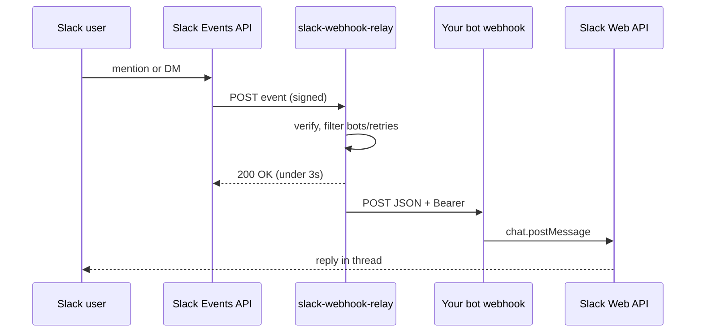

# easy-ai-bot-bridge

Small, self-hostable **bridges** between chat platforms and AI bot webhooks (e.g. a Grok Bot routine with an HTTP trigger). Each bridge lives in its own folder with its own CDK stack. Deploy only what you need.

## The problem

You want your AI bot to power a **Slack agent**: someone @-mentions the app or DMs it, the bot thinks, and the answer appears in the thread. Slack's Events API can POST to your endpoint, but that does not map cleanly onto a typical bot webhook:

| Slack needs | Typical bot webhook expects |
| --- | --- |
| `url_verification` challenge echoed as plaintext | JSON API |
| HTTP 200 within ~3 seconds | May run longer |
| Retries on slow responses | Duplicate work if you forward again |
| No custom `Authorization: Bearer` header on the Event URL | Bearer token on every call |
| Risk of bot-message loops | N/A |

**slack-webhook-relay** sits in the middle: verify Slack's signature, answer the challenge, ack fast, drop retries and bot messages, and forward a small JSON body to your webhook with `Authorization: Bearer`. Your bot posts back to Slack itself via [`chat.postMessage`](https://api.slack.com/methods/chat.postMessage) (`channel` + `thread_ts`).

## Flow



## Bridges

| Bridge | Path | Status |
| --- | --- | --- |
| **slack-webhook-relay** | [`relay/slack-webhook-relay/`](relay/slack-webhook-relay/) | Available. One workspace, Lambda Function URL, ~$0.40/mo idle (Secrets Manager). |
| *(more planned)* | `relay/...` | Not yet. |

Details, routine prompt, and layout: [`relay/slack-webhook-relay/README.md`](relay/slack-webhook-relay/README.md).

## Quick start (slack-webhook-relay)

1. **Slack app** (single workspace): Bot scopes `app_mentions:read`, `chat:write`, `im:history`. Bot events `app_mention`, `message.im`. Install and note the signing secret; store the **bot token** in your Grok Bot (the relay does not need it).
2. **Deploy**

   ```bash
   cd relay/slack-webhook-relay
   npm ci && npm test
   npx cdk deploy
   ```

3. **Secret** (output `SecretArn`): `SLACK_SIGNING_SECRET`, `WEBHOOK_URL`, `WEBHOOK_KEY` for your routine webhook.
4. **Event Subscriptions**: Request URL = CloudFormation output `FunctionUrl`. Set this **after** the secret is filled so `url_verification` succeeds.

## Payload your bot receives

```json
{
  "source": "slack",
  "team": "T0123456789",
  "channel": "C0LAN2Q65",
  "user": "U111",
  "text": "What is the weather today?",
  "ts": "1731448800.000100",
  "thread_ts": "1731448800.000100",
  "event_id": "Ev01ABC"
}
```

Answer `text`, then post to Slack with your bot token. See the relay README for a copy-paste routine prompt.

## Security

- The relay holds the **signing secret** and **webhook bearer key**, not the Slack bot token.
- Anyone in the workspace who can talk to the app can trigger your bot. Use a **dedicated bot** without access to personal or sensitive data.
- Keep AWS and Slack credentials in Secrets Manager or env vars; never commit them.

## Multi-tenant bridge (experimental)

The repo root also contains a **paused** multi-tenant design: Cognito Google login API, DynamoDB, SQS, and per-tenant routing (`lib/`, `src/`). It is **experimental and unsupported** -- not documented for production, not the focus of this collection. Use **slack-webhook-relay** unless you plan to fork and operate the full stack yourself.

```bash
# optional: run unit tests for the experimental stack
npm ci && npm test
```

## License

MIT. See [LICENSE](LICENSE) and [CONTRIBUTING.md](CONTRIBUTING.md).