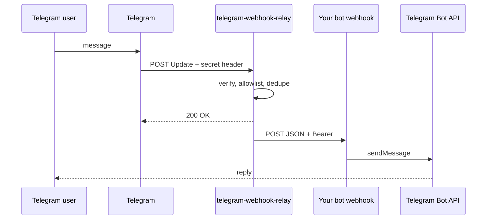

# easy-ai-bot-bridge

A growing collection of small, self-hostable **bridges** between chat platforms and AI bot webhooks (e.g. a Grok Bot routine with an HTTP trigger). Each bridge is a standalone CDK app under `relay/`. Deploy only what you need.

## The problem

You want your AI bot to power a **chat agent** on Slack or Telegram. The platform can POST events to your URL, but that does not match what a typical bot webhook expects:

| Platform constraint | Typical bot webhook |
| --- | --- |
| Custom auth headers the platform supports (Slack signing secret, Telegram `secret_token`) | `Authorization: Bearer` on every call |
| Platform-specific JSON (`url_verification`, Telegram `Update` objects) | Small, stable JSON you control |
| Fast HTTP 200 or the platform retries | May run longer than a few seconds |
| Loops from bot messages | N/A |

**Bridges** verify the platform, ack quickly, filter noise (retries, bots, non-allowlisted users where configured), and POST a **normalized JSON body** to your webhook with `Authorization: Bearer`. Your bot sends replies with the **platform bot token** (`chat.postMessage`, `sendMessage`), stored in the AI bot, not in the relay.

### Slack ([`slack-webhook-relay`](relay/slack-webhook-relay/))

Slack needs a `url_verification` challenge, answers within ~3s, cannot send Bearer to the Event URL, and may retry. See the Slack bridge README for scopes and routine prompt.

### Telegram ([`telegram-webhook-relay`](relay/telegram-webhook-relay/))

Telegram webhooks send `X-Telegram-Bot-Api-Secret-Token`, not Bearer auth, and wrap messages in `Update` objects. This relay maps that to your bot webhook and lets you **allowlist** which Telegram user ids may trigger the bot.

## Flow (Telegram example)



## Bridges

| Bridge | Path | Status |
| --- | --- | --- |
| **slack-webhook-relay** | [`relay/slack-webhook-relay/`](relay/slack-webhook-relay/) | Available. One Slack workspace, Lambda Function URL. |
| **telegram-webhook-relay** | [`relay/telegram-webhook-relay/`](relay/telegram-webhook-relay/) | Available. One Telegram bot, allowlisted users, Lambda Function URL. |
| *(more planned)* | `relay/...` | Not yet. |

## Quick start

Pick a bridge, then:

```bash
cd relay/<bridge-name>
npm ci && npm test
npx cdk deploy
```

Configure secrets and platform webhooks per bridge README:

- Slack: [`relay/slack-webhook-relay/README.md`](relay/slack-webhook-relay/README.md)
- Telegram: [`relay/telegram-webhook-relay/README.md`](relay/telegram-webhook-relay/README.md)

## Security

- Relays hold **platform verification secrets** and **webhook bearer keys**, not the Slack/Telegram **bot tokens** used to post replies.
- Restrict who can trigger the bot (Slack: workspace membership; Telegram: `ALLOWED_USER_IDS`).
- Use a dedicated bot without personal or sensitive data.
- Do not commit secrets or production URLs.

## License

MIT. See [LICENSE](LICENSE) and [CONTRIBUTING.md](CONTRIBUTING.md).