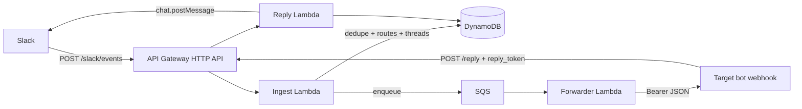
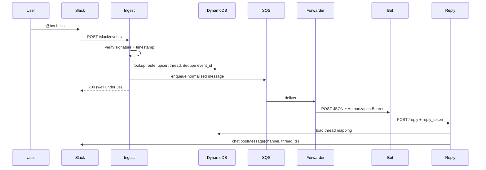

# easy-ai-bot-bridge

Serverless webhook bridge that lets chat platforms and bots that cannot talk
directly (Slack today, Telegram later, Grok Bot routines, ...) exchange messages.

A Grok Bot connected to Slack natively only replies to its owner. This project
gives you **your own Slack app**: anyone in the workspace can @-mention it, the
bridge forwards the message to a Grok Bot routine webhook, and the bot's answer
is posted back into the same Slack thread.

The core is platform-agnostic. Each chat network is a thin adapter (verify
signature, parse inbound, post reply). Telegram is stubbed, not implemented.

This repository does **not** deploy itself. You need an AWS account and a Slack
app; see [Deploy](#deploy).

## Architecture





| Piece | Role |
| --- | --- |
| API Gateway HTTP API | `POST /slack/events`, `POST /reply` |
| Ingest Lambda | Verify Slack signing secret, handle `url_verification`, ignore bot/self messages, dedupe `event_id`, normalise, enqueue, ack 200 |
| SQS + DLQ | Buffer + retries (5) then dead-letter |
| Forwarder Lambda | POST JSON to the configured target webhook |
| Reply Lambda | Validate HMAC reply token, load thread mapping, adapter `postReply` |
| DynamoDB `events` | Dedupe keys, TTL ~48h |
| DynamoDB `threads` | `platform` conversation -> channel / `thread_ts` for replies, TTL ~90d |
| DynamoDB `routes` | Which target webhook handles which Slack workspace/channel |
| Secrets Manager | Slack signing secret, bot token, target webhook key, callback signing secret |

**Design choices (v1):**

- **HMAC reply tokens** (thread id + expiry, signed with `callbackSigningSecret`) instead of storing a random token per thread. Stateless, 7-day expiry. The `threads` table is still required so we know which Slack channel/`thread_ts` to post to.
- **One Secrets Manager secret** (JSON object) rather than four secrets, so idle cost stays at one secret (~$0.40/month).
- **Routes table + optional env default.** Channel row wins; a disabled channel row mutes that channel; workspace `channel#*` is next; `DEFAULT_TARGET_WEBHOOK_URL` is last.
- Slack retries (`X-Slack-Retry-*`) are handled by **dedupe**, not by dropping retries. If enqueue fails, the dedupe row is deleted so Slack's retry can succeed.
- Lambdas run **arm64 / 256 MB**. Ingest timeout is 5s so Slack's 3s ack budget is the real constraint (the handler only hits DynamoDB + SQS).

## Adapter interface

```ts
export interface PlatformAdapter {
  readonly platform: string;
  verifyRequest(args: VerifyRequestArgs): void;
  parseInbound(body: unknown, options?: { botUserId?: string }): InboundResult;
  postReply(args: {
    target: ReplyTarget;
    text: string;
    credentials: PlatformCredentials;
    fetchFn: typeof fetch;
  }): Promise<void>;
}
```

See `src/adapters/types.ts`. Slack is implemented in `src/adapters/slack.ts`.
Telegram is a throwing stub in `src/adapters/telegram.ts` with comments on
signature, parse, and `sendMessage` so a later PR can fill it in and add
`POST /telegram/webhook`.

## Payload the bot receives

The forwarder POSTs JSON to the target webhook with

`Authorization: Bearer <targetWebhookKey>`

(`targetWebhookKeys[targetId]` if you configured a per-target key).

```json
{
  "thread": "slack:T0123456789:C0LAN2Q65:1731448800.000100",
  "text": "What is the weather today?",
  "sent_at": "2024-11-12T22:00:00.000Z",
  "platform": "slack",
  "sender": {
    "id": "U111",
    "display_name": null,
    "username": null
  },
  "conversation": {
    "workspace_id": "T0123456789",
    "channel_id": "C0LAN2Q65",
    "thread_ts": "1731448800.000100"
  },
  "reply_url": "https://xxxxxxxxxx.execute-api.us-east-1.amazonaws.com/reply",
  "reply_token": "<hmac-token>"
}
```

`thread`, `text`, and `sent_at` are the fields already verified against a Grok
Bot routine webhook (HTTP 200 in under 1s; UTF-8 text is fine). Extra fields
tell the bot how to answer. Leading `<@UBOT>` mentions are stripped from `text`.

If the Slack event already has a `thread_ts`, that is the conversation id (replies
stay in the existing thread). Otherwise the message `ts` is used so `chat.postMessage`
opens a thread on the mention.

## Curl the bot should run to reply

Use `reply_url` and `reply_token` from the payload. Do **not** send the Slack bot
token; the bridge holds that.

```bash
# Values copied from the inbound webhook JSON:
REPLY_URL="https://xxxxxxxxxx.execute-api.us-east-1.amazonaws.com/reply"
REPLY_TOKEN="<hmac-token>"
THREAD="slack:T0123456789:C0LAN2Q65:1731448800.000100"

curl -sS -X POST "$REPLY_URL" \
  -H "Authorization: Bearer $REPLY_TOKEN" \
  -H "Content-Type: application/json; charset=utf-8" \
  -d "$(jq -n --arg thread "$THREAD" --arg text "Sunny, 20C." '{thread:$thread, text:$text}')"
```

Expected response: `{"ok":true}`. The bridge then calls Slack `chat.postMessage`
with the mapped `channel` and `thread_ts`.

Tokens expire after 7 days. A 401 means a bad/expired token; 404 means the thread
mapping is gone (TTL or never ingested).

## Configure a target

After deploy, pick a Slack workspace/channel and point it at a webhook.

Workspace-wide default (every channel in `T0123456789`):

```bash
export ROUTES_TABLE=EasyAiBotBridge-RoutesXXXXXXXX
export WORKSPACE_ID=T0123456789          # Slack team id
export CHANNEL_ID=*                      # or a channel id like C0LAN2Q65
export TARGET_WEBHOOK_URL=https://your-grok-bot.example/routine
export TARGET_ID=default-grok
npx tsx scripts/put-route.ts
```

Or raw DynamoDB:

```bash
aws dynamodb put-item --table-name "$ROUTES_TABLE" --item '{
  "pk": {"S": "slack#T0123456789"},
  "sk": {"S": "channel#*"},
  "platform": {"S": "slack"},
  "workspaceId": {"S": "T0123456789"},
  "channelId": {"S": "*"},
  "targetWebhookUrl": {"S": "https://your-grok-bot.example/routine"},
  "targetId": {"S": "default-grok"},
  "enabled": {"BOOL": true}
}'
```

Keys:

- `pk` = `{platform}#{workspaceId}`
- `sk` = `channel#{channelId}` or `channel#*`

Set `enabled` to `false` on a **channel** row to mute that channel even if a
workspace wildcard exists.

For a first install you can skip the table and deploy with

`-c defaultTargetWebhookUrl=https://your-grok-bot.example/routine`

which sets `DEFAULT_TARGET_WEBHOOK_URL` on the ingest Lambda.

Per-target bearer keys: add `targetWebhookKeys` to the secret JSON
(`{ "default-grok": "..." }`). Otherwise every route uses `targetWebhookKey`.

## Slack app setup

1. [Create a Slack app](https://api.slack.com/apps) from scratch, in the
   workspace you want to serve.
2. **OAuth & Permissions -> Bot Token Scopes**
   - `app_mentions:read` -- inbound @-mentions in channels
   - `chat:write` -- post the bot's reply
   - `im:history` -- DMs to the app (subscribe to `message.im`)
   - optional: `im:read`, `users:read` (display names later)
3. **Event Subscriptions**
   - Enable events
   - Request URL = CloudFormation output `SlackEventsUrl`
     (`https://{api-id}.execute-api.{region}.amazonaws.com/slack/events`)
   - Subscribe to **bot events**: `app_mention`, `message.im`
   - Slack will POST `url_verification`; this app responds with the
     `challenge` value as plaintext. **Put the signing secret in Secrets
     Manager before you set the Request URL**, otherwise verification fails.
4. Install the app to the workspace. Copy:
   - **Signing Secret** (Basic Information)
   - **Bot User OAuth Token** (`xoxb-...`)
   - Bot user id (`U...` / `W...`) if you want ingest to drop the bot's own
     messages via `-c slackBotUserId=U...`
5. Invite the bot to each channel it should hear: `/invite @YourBot`.
6. Point the Events Request URL at the deployed API, then @-mention the bot.

## Deploy

You need Node 22+, AWS credentials with permission to create API Gateway,
Lambda, SQS, DynamoDB, Secrets Manager, IAM, and CloudWatch Logs, and a region
(examples use `us-east-1`).

```bash
npm ci
npm test          # unit + mocked e2e
npm run synth     # cdk synth -- must complete cleanly
export CDK_DEFAULT_REGION=us-east-1
npx cdk bootstrap aws://$AWS_ACCOUNT_ID/$CDK_DEFAULT_REGION   # once per account/region
npx cdk deploy \
  -c defaultTargetWebhookUrl=https://your-grok-bot.example/routine \
  -c slackBotUserId=U0123456789
```

Note the stack outputs: `ApiUrl`, `SlackEventsUrl`, `ReplyUrl`, `SecretArn`,
`RoutesTableName`, `DlqUrl`.

### Fill in secrets (never commit them)

Deploy creates one secret whose JSON looks like:

```json
{
  "slackSigningSecret": "REPLACE_ME",
  "slackBotToken": "REPLACE_ME",
  "targetWebhookKey": "REPLACE_ME",
  "callbackSigningSecret": "<randomly generated>"
}
```

Keep the generated `callbackSigningSecret`. Replace the `REPLACE_ME` values:

```bash
aws secretsmanager get-secret-value --secret-id "$SECRET_ARN" \
  --query SecretString --output text > /tmp/bridge-secret.json
# edit /tmp/bridge-secret.json -- do not commit it
aws secretsmanager put-secret-value --secret-id "$SECRET_ARN" \
  --secret-string file:///tmp/bridge-secret.json
rm /tmp/bridge-secret.json
```

`targetWebhookKey` is the bearer token the **bridge sends** to the Grok Bot
webhook (`Authorization: Bearer ...`). `callbackSigningSecret` is used only to
sign `/reply` tokens.

Then write a routes row (see [Configure a target](#configure-a-target)) and
finish the Slack app Event Subscriptions URL.

This repo does not run `cdk deploy` in CI; there are no AWS or Slack credentials
in the environment that built it.

## Local tests

```bash
npm test
```

Covered without AWS or Slack:

- Slack signing secret + timestamp window
- `event_id` dedupe (including enqueue-failure rollback)
- Route lookup (channel / wildcard / env default / mute)
- `/reply` HMAC token, 401/404, and `chat.postMessage` body
- Mocked path: Slack `app_mention` -> forwarded webhook JSON -> `/reply` ->
  `chat.postMessage` with the right `channel` and `thread_ts` (including a
  non-ASCII UTF-8 round trip using escaped Unicode)

## AWS cost at low volume

Idle cost is dominated by **Secrets Manager** (billed per secret per month even
at zero traffic). Everything else is on-demand / free-tier friendly.

Assumptions: ~1,000 mentions / month, 256 MB Lambdas, arm64, on-demand
DynamoDB, one secret, HTTP API, one SQS queue + DLQ, log retention 14 days.

| Service | ~1k msgs/month | Notes |
| --- | --- | --- |
| Secrets Manager | **$0.40** | 1 secret; $0.05 per 10k API calls is noise |
| API Gateway HTTP API | < $0.01 | $1.00 / million requests; 2 calls/msg |
| Lambda | $0.00 | Well inside the 1M-request / 400k GB-s free tier |
| SQS | $0.00 | First 1.2M requests/month free |
| DynamoDB on-demand | < $0.01 | A few KB per event/thread/route |
| CloudWatch Logs | pennies | 14-day retention |
| Data transfer | ~$0 | Same-region |

**Floor at zero traffic: ~$0.40/month.** At a few thousand messages, still
about **$0.40-$1.00/month**. At 100k messages/month, still a few dollars;
revisit log volume and DynamoDB TTLs before anything else.

## Project layout

```
bin/app.ts                 CDK app
lib/bridge-stack.ts        HTTP API, Lambdas, SQS, DynamoDB, secret
src/adapters/              Slack + Telegram stub
src/ingest/handler.ts      POST /slack/events
src/forwarder/handler.ts   SQS -> target webhook
src/reply/handler.ts       POST /reply
src/lib/                   routing, HMAC tokens, DynamoDB, secrets
scripts/put-route.ts       upsert a routes table item
test/                      vitest unit + mocked e2e
```
