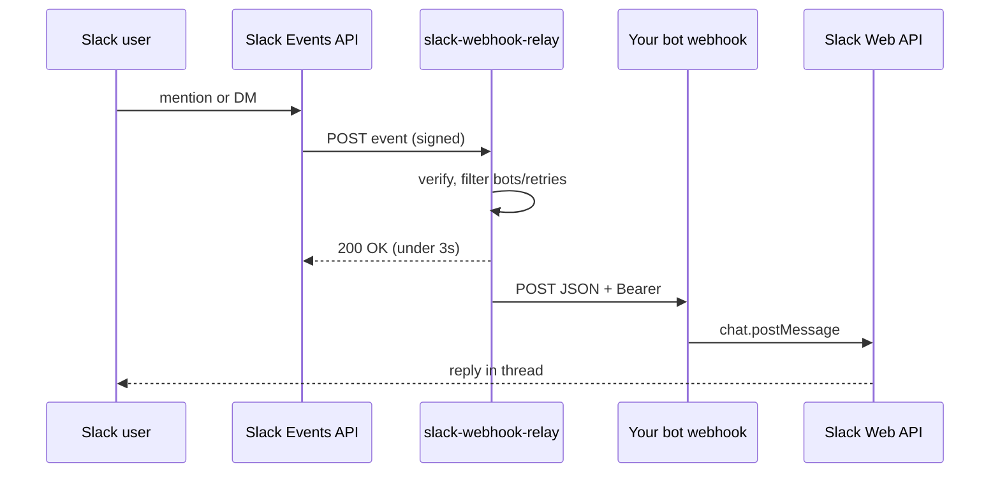

# easy-ai-bot-bridge

A growing collection of small, self-hostable **bridges** between chat platforms and AI bot webhooks (e.g. a Grok Bot routine with an HTTP trigger). Each bridge is a standalone CDK app under `relay/`. Deploy only what you need.

**Today:** [`relay/slack-webhook-relay`](relay/slack-webhook-relay/) is the first bridge. More may appear as siblings under `relay/` later.

## The problem

You want your AI bot to power a **Slack agent**: someone @-mentions the app or DMs it, the bot thinks, and the answer appears in the thread. Slack's Events API can POST to your URL, but that does not fit a typical bot webhook:

| Slack needs | Typical bot webhook expects |
| --- | --- |
| `url_verification` challenge echoed as plaintext | JSON API |
| HTTP 200 within ~3 seconds | May run longer |
| Retries on slow responses | Duplicate work if you forward again |
| No custom `Authorization: Bearer` on the Event URL | Bearer token on every call |
| Risk of bot-message loops | N/A |

**slack-webhook-relay** verifies Slack's signature, answers the challenge, acks fast, drops retries and bot messages, and forwards a small JSON body with `Authorization: Bearer`. Your bot posts back to Slack via [`chat.postMessage`](https://api.slack.com/methods/chat.postMessage) using `channel` and `thread_ts` (token lives in the bot, not in the relay).

## Flow



## Bridges

| Bridge | Path | Status |
| --- | --- | --- |
| **slack-webhook-relay** | [`relay/slack-webhook-relay/`](relay/slack-webhook-relay/) | Available. One workspace, Lambda Function URL, ~$0.40/mo idle (Secrets Manager). |
| *(more planned)* | `relay/...` | Not yet. |

## Quick start

1. **Slack app** (one workspace): Bot scopes `app_mentions:read`, `chat:write`, `im:history`. Bot events `app_mention`, `message.im`. Install the app; keep the **signing secret** for the relay and the **bot token** in your Grok Bot.
2. **Deploy and test**

   ```bash
   cd relay/slack-webhook-relay
   npm ci && npm test
   npx cdk deploy
   ```

3. **Secret** (output `SecretArn`): `SLACK_SIGNING_SECRET`, `WEBHOOK_URL`, `WEBHOOK_KEY`.
4. **Event Subscriptions**: Request URL = output `FunctionUrl` (set after the secret is filled so `url_verification` succeeds).

Step-by-step Slack setup, routine prompt, env-var mode, and layout: [`relay/slack-webhook-relay/README.md`](relay/slack-webhook-relay/README.md).

## Payload your bot receives

```json
{
  "source": "slack",
  "team": "T0123456789",
  "channel": "C0LAN2Q65",
  "user": "U111",
  "text": "What is the weather today?",
  "ts": "1731448800.000100",
  "thread_ts": "1731448800.000100",
  "event_id": "Ev01ABC"
}
```

## Security

- The relay stores the **signing secret** and **webhook bearer key**, not the Slack bot token.
- Anyone in the workspace who can talk to the app can trigger your bot. Use a **dedicated bot** without personal or sensitive data.
- Do not commit secrets or production URLs.

## License

MIT. See [LICENSE](LICENSE) and [CONTRIBUTING.md](CONTRIBUTING.md).